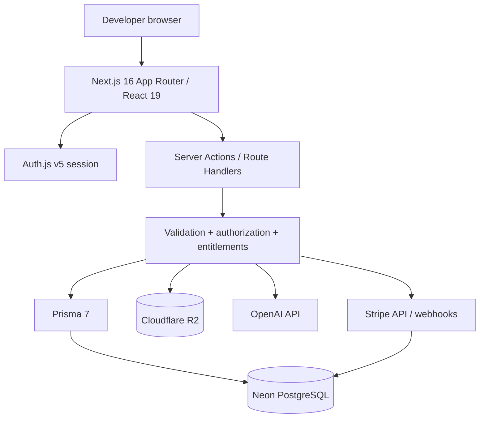
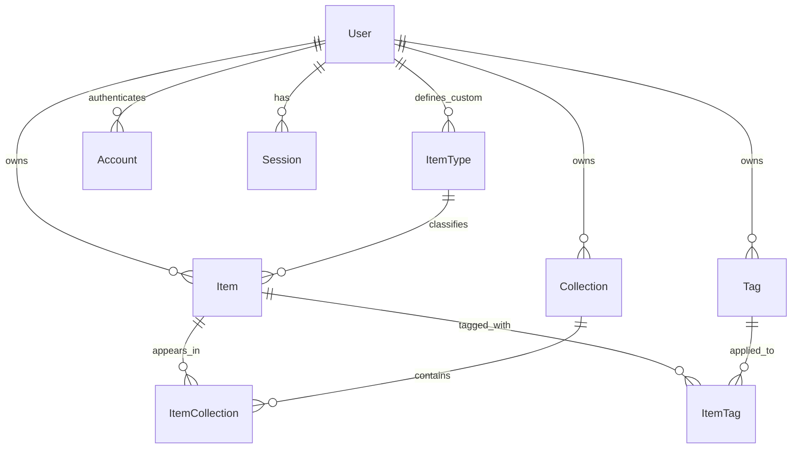
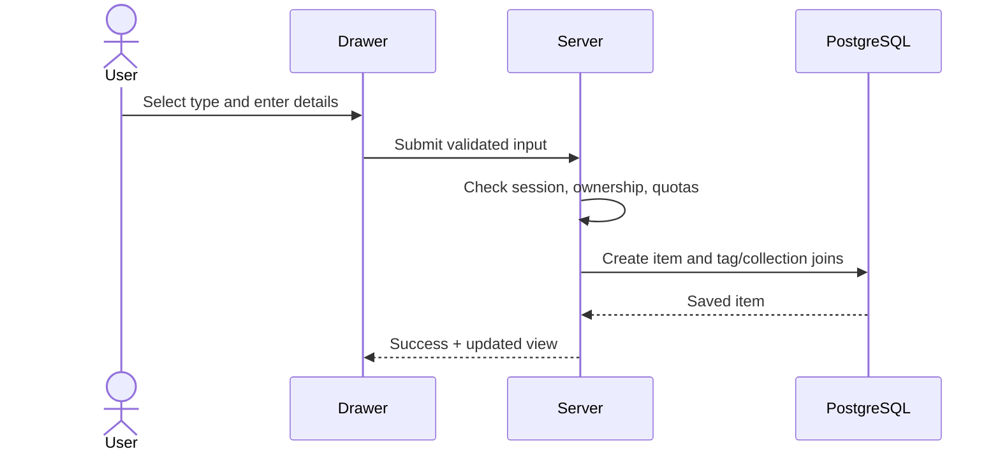

# DevStash — Project Overview

> **Status:** In development · **Product:** Developer knowledge hub · **Approach:** Single Next.js application

## Current implementation (2026-10-27)

The dashboard and responsive sidebar use owner-scoped Prisma queries against Neon PostgreSQL. They display item and collection statistics, recent collections, pinned and recent items, system types with item counts, favorite collections, and the signed-in user's profile. Auth Phase 1 adds NextAuth v5 GitHub OAuth with the Prisma adapter and JWT sessions. A proxy redirects unauthenticated dashboard requests to the default sign-in page; server-side user checks scope dashboard data to the authenticated user. GitHub login and the final callback still require user verification.

Implemented foundations include Next.js 16, React 19, Tailwind CSS 4, shadcn/ui, Prisma 7, a versioned initial migration, a repeatable development seed, and `npm run db:check` for database verification. Development and production builds use Webpack with Tailwind's PostCSS plugin. The latest production build and lint passed; the latest sidebar browser verification remains unconfirmed after tool timeouts.

Auth Phase 2 adds credentials authentication and registration with bcrypt and Zod, shared PostgreSQL request/account throttling, canonical email identity across credentials and OAuth, and targeted security regression tests. See [authentication security](auth-security.md) for limits, trusted-proxy configuration, and migration requirements. Custom auth UI, item and collection CRUD, search, uploads, AI actions, billing, and broader automated application tests remain planned. The sections below describe the target architecture and product scope; they do not imply that these capabilities are implemented. See [feature history](current-feature.md) for completed work.

## Design

Refer to the screenshot below as a base for the dashboard. It does not have to be exact, use it as a reference:

- @context/screenshots/dashboard-ui-drawer.png
- @context/screenshots/dashboard-ui-main.png

## 1. Vision and problem

Developers scatter reusable knowledge across editors, chat histories, bookmarks, documents, gists and terminal history. DevStash consolidates snippets, AI prompts, notes, commands, links and uploaded assets into **one fast, searchable workspace** with optional AI assistance.

**Product promise:** Save in seconds, find in seconds, reuse anywhere.

### Target users

| Persona | Primary job |
|---|---|
| Everyday developer | Retrieve snippets, commands and links quickly |
| AI-first developer | Organize prompts, context files and workflows |
| Educator / creator | Reuse explanations, code and course notes |
| Full-stack builder | Store patterns, boilerplates and API examples |

## 2. Scope and delivery phases

| Capability | MVP | Later |
|---|:---:|:---:|
| Email/password and GitHub authentication | ✓ | |
| System item types, CRUD, quick drawer | ✓ | |
| Collections (many-to-many), tags | ✓ | |
| Favorites, pinned items, recent items | ✓ | |
| Title/content/tag/type search | ✓ | Advanced ranking and filters |
| Markdown editor, syntax highlighting | ✓ | |
| Dark/light theme, responsive sidebar | ✓ | |
| File/image upload to R2 | ✓* | |
| File-to-snippet import | ✓ | More parsers |
| JSON export | ✓* | ZIP / asset bundle |
| Subscription billing and quotas | Foundation | Enforcement / live checkout |
| AI tagging, summaries, code explanation, prompt optimization | ✓* | More AI workflows |
| Custom item types | | ✓ |
| Redis caching | | Only if measurements justify it |

\* **Development mode:** All features are accessible to authenticated users while building; production entitlements will be enforced server-side before launch.

### Non-goals for MVP

Team workspaces, shared/public collections, real-time collaboration, browser extensions, VS Code extensions, semantic/vector search, AI agents and complex document parsing.

## 3. Item system

### Built-in types

| Slug / route | Icon (Lucide) | Color | Storage kind | Planned production access |
|---|---|---|---|---|
| `snippet` → `/items/snippets` | `code` | `#3b82f6` | TEXT | Free |
| `prompt` → `/items/prompts` | `sparkles` | `#8b5cf6` | TEXT | Free |
| `command` → `/items/commands` | `terminal` | `#f97316` | TEXT | Free |
| `note` → `/items/notes` | `sticky-note` | `#fde047` | TEXT | Free |
| `file` → `/items/files` | `file` | `#6b7280` | FILE | Pro |
| `image` → `/items/images` | `image` | `#ec4899` | FILE | Pro |
| `link` → `/items/links` | `link` | `#10b981` | URL | Free |

System types are immutable and globally available. Future custom types are owned by a user, have unique per-owner slugs and must declare a storage kind. **Content type is `TEXT | URL | FILE`**, not just text/file. A link stores its destination separately from optional notes. Use stable slugs for URLs; display names may change.

**Item behavior:** A user can save an item without a collection, add it to multiple collections, remove it from one collection without deleting it, favorite it, pin it and see all its collection memberships. The item drawer supports fast create/view/edit/copy and keyboard-friendly actions.

## 4. Collections, tags and search

- Collections mix item types; memberships are many-to-many and record `addedAt`.
- A collection may have an optional `defaultTypeId` for the quick-add form; this does **not** constrain which item types the collection can contain.
- Tags are user-scoped and normalized case-insensitively to prevent duplicates. Items can have multiple tags.
- Search includes titles, descriptions, text content, tags and type; results are always scoped to the signed-in owner.
- **MVP search:** PostgreSQL full-text search for text plus indexed title/tag filters, with a sensible substring fallback for short queries. Do not search binary file contents until extraction is explicitly built.
- Track recently opened items using `lastOpenedAt`; favorites and pins are independent booleans.
- Collection color is derived from the most common item type; for ties use a deterministic ordering, and use a neutral fallback for empty collections. Do not persist a redundant derived color.

## 5. Proposed system architecture



Use Server Components for initial lists and details; use Client Components for the editor, drawer, command palette and interactions. Use Server Actions for internal mutations where appropriate and Route Handlers for uploads, webhooks and integration endpoints. Never treat UI hiding as authorization.

## 6. Prisma data model (proposed)

The schema below is a **design baseline**, not a migration-ready guarantee for every Auth.js adapter. Align the auth tables with the selected Auth.js Prisma adapter before generating migrations. Prisma 7 configuration and database adapters should follow the version-specific official docs.

```prisma
// prisma/schema.prisma — domain schema proposal
// Prisma 7 datasource URL is configured in prisma.config.ts.
generator client {
  provider = "prisma-client"
  output   = "../src/generated/prisma"
}

datasource db {
  provider = "postgresql"
}

enum ContentKind {
  TEXT
  URL
  FILE
}

enum Plan {
  FREE
  PRO
}

model User {
  id                   String       @id @default(cuid())
  name                 String?
  email                String?      @unique
  emailVerified        DateTime?
  image                String?
  passwordHash         String?      // Credentials auth; never plaintext
  plan                 Plan         @default(FREE)
  stripeCustomerId     String?      @unique
  stripeSubscriptionId String?      @unique
  subscriptionStatus   String?
  currentPeriodEnd     DateTime?
  accounts             Account[]
  sessions             Session[]
  items                Item[]
  collections          Collection[]
  tags                 Tag[]
  customTypes          ItemType[]
  createdAt            DateTime     @default(now())
  updatedAt            DateTime     @updatedAt
}

// Adapt these fields to the exact installed Auth.js Prisma adapter contract.
model Account {
  id                String  @id @default(cuid())
  userId            String
  type              String
  provider          String
  providerAccountId String
  refresh_token     String? @db.Text
  access_token      String? @db.Text
  expires_at        Int?
  token_type        String?
  scope             String?
  id_token          String? @db.Text
  session_state     String?
  user              User    @relation(fields: [userId], references: [id], onDelete: Cascade)
  @@unique([provider, providerAccountId])
}

model Session {
  sessionToken String   @unique
  userId       String
  expires      DateTime
  user         User     @relation(fields: [userId], references: [id], onDelete: Cascade)
}

model VerificationToken {
  identifier String
  token      String   @unique
  expires    DateTime
  @@unique([identifier, token])
}

model ItemType {
  id                 String       @id @default(cuid())
  slug               String
  name               String
  icon               String
  color              String
  kind               ContentKind
  isSystem           Boolean      @default(false)
  userId             String?
  user               User?        @relation(fields: [userId], references: [id], onDelete: Cascade)
  items              Item[]
  defaultCollections Collection[] @relation("CollectionDefaultType")
  @@unique([userId, slug])
  @@index([isSystem, slug])
  // Enforce unique global system slugs with a partial SQL index.
}

model Item {
  id            String           @id @default(cuid())
  userId        String
  typeId        String
  title         String
  description   String?          @db.Text
  content       String?          @db.Text
  url           String?          @db.Text
  fileKey       String?          // Private R2 object key; NOT a public URL
  fileName      String?
  fileSize      BigInt?
  fileMimeType  String?
  language      String?
  isFavorite    Boolean          @default(false)
  isPinned      Boolean          @default(false)
  lastOpenedAt  DateTime?
  createdAt     DateTime         @default(now())
  updatedAt     DateTime         @updatedAt
  user          User             @relation(fields: [userId], references: [id], onDelete: Cascade)
  type          ItemType         @relation(fields: [typeId], references: [id])
  collections   ItemCollection[]
  tags          ItemTag[]
  @@index([userId, updatedAt])
  @@index([userId, typeId, isPinned])
  @@index([userId, lastOpenedAt])
}

model Collection {
  id            String           @id @default(cuid())
  userId        String
  name          String
  description   String?          @db.Text
  isFavorite    Boolean          @default(false)
  defaultTypeId String?
  createdAt     DateTime         @default(now())
  updatedAt     DateTime         @updatedAt
  user          User             @relation(fields: [userId], references: [id], onDelete: Cascade)
  defaultType   ItemType?        @relation("CollectionDefaultType", fields: [defaultTypeId], references: [id], onDelete: SetNull)
  items         ItemCollection[]
  @@index([userId, updatedAt])
}

model ItemCollection {
  itemId       String
  collectionId String
  addedAt      DateTime   @default(now())
  item         Item       @relation(fields: [itemId], references: [id], onDelete: Cascade)
  collection   Collection @relation(fields: [collectionId], references: [id], onDelete: Cascade)
  @@id([itemId, collectionId])
  @@index([collectionId, addedAt])
}

model Tag {
  id        String    @id @default(cuid())
  userId    String
  name      String
  slug      String
  user      User      @relation(fields: [userId], references: [id], onDelete: Cascade)
  items     ItemTag[]
  @@unique([userId, slug])
}

model ItemTag {
  itemId String
  tagId  String
  item   Item   @relation(fields: [itemId], references: [id], onDelete: Cascade)
  tag    Tag    @relation(fields: [tagId], references: [id], onDelete: Cascade)
  @@id([itemId, tagId])
}
```

### Entity relationships



**Important integrity rules (service layer and/or SQL constraints):**

1. Item, collection, tag and type must belong to the same user, except globally defined system types. Foreign keys alone do not guarantee this cross-owner rule.
2. Match fields to `ItemType.kind`: TEXT requires content, URL requires a valid safe `https://` or `http://` URL, FILE requires an owned R2 key. Decide whether empty drafts are allowed before adding SQL `CHECK` constraints.
3. System types must have `userId = NULL`, be immutable and have globally unique slugs; custom types must have a non-null owner. A PostgreSQL partial unique index is needed because `@@unique([userId, slug])` does not make `NULL` owner slugs globally unique.
4. The collection default type must be system-wide or owned by that collection's user.
5. Add a user-scoped PostgreSQL full-text index via a reviewed SQL migration; Prisma schema indexes alone do not implement the entire search strategy.
6. Deleting a file item should schedule safe R2 object cleanup; use a retryable cleanup job/outbox to avoid database/storage inconsistencies.

## 7. Navigation and interface

```text
App shell
├── Sidebar (collapsible; mobile drawer)
│   ├── All Items
│   ├── Snippets / Prompts / Notes / Commands / Links / Files / Images
│   ├── Favorites / Pinned / Recently Used
│   └── Recent Collections → All Collections
├── Header (search, quick add, theme, profile)
└── Main area
    ├── Collection cards (dominant-type accent)
    ├── Item cards (type-colored border)
    └── Item detail/create/edit drawer
```

### Suggested routes

| Route | Purpose |
|---|---|
| `/` | Redirect to dashboard or sign-in |
| `/dashboard` | Overview, recent items, favorite collections |
| `/items` | All items |
| `/items/[type]` | Type-filtered items, e.g. `/items/snippets` |
| `/collections` | Collection index |
| `/collections/[id]` | Mixed-type collection contents |
| `/favorites` | Favorite items and collections |
| `/settings` | Profile, theme, data export |
| `/settings/billing` | Plan and subscription management |
| `/sign-in`, `/sign-up` | Authentication |

The drawer can be controlled by local UI state or URL-based intercepted/parallel routes so deep links and browser history work. Use accessible keyboard navigation, focus management and screen-reader labels. Provide loading skeletons, toasts, optimistic updates where safe and a copy-to-clipboard button for snippets/commands/prompts.

## 8. Technical stack

| Layer | Choice | Notes |
|---|---|---|
| Application | Next.js 16, React 19, TypeScript | App Router, one repository |
| UI | Tailwind CSS 4, shadcn/ui, Lucide | Dark by default, light optional |
| Data | Neon PostgreSQL, Prisma 7 | Managed PostgreSQL, migration-only schema changes |
| Authentication | Auth.js / NextAuth v5 | GitHub OAuth and credentials with hashed passwords |
| Storage | Cloudflare R2 | Private bucket, signed upload/download flows |
| AI | OpenAI `gpt-5-nano` | Verify model availability, API support and current pricing before implementation |
| Billing | Stripe | Checkout, customer portal, verified webhooks |
| Caching | None initially | Add Redis only for a measured bottleneck |
| Testing | Vitest + Playwright (suggested) | Unit, integration, end-to-end |
| CI | GitHub Actions (suggested) | Typecheck, lint, test, build, migration checks |

### Suggested code organization

```text
src/
  app/                     # App Router pages, layouts, route handlers
  components/              # Shared UI and editor/drawer components
  features/
    items/                 # validation, queries, actions, services, UI
    collections/
    tags/
    search/
    uploads/
    ai/
    billing/
  lib/                     # auth, prisma client, R2, OpenAI, Stripe
  generated/prisma/        # generated client (ignored as appropriate)
prisma/
  schema.prisma
  migrations/
prisma.config.ts
```

Keep data access and authorization on the server. Prefer feature-based modules over a large, undifferentiated `utils` folder.

## 9. Subscription and access policy

| Feature | Free | Pro |
|---|---|---|
| Items | 50 total | Unlimited (subject to fair-use controls) |
| Collections | 3 | Unlimited |
| Built-in text/link types | ✓ | ✓ |
| File and image upload | — | ✓ |
| Basic search | ✓ | ✓ |
| AI tagging / summary / explain / optimize | — | ✓ |
| Export | To decide | JSON / ZIP |
| Custom types | — | Later |
| Support | Standard | Priority |
| Price | $0 | **$8/month** or **$72/year** |

**Billing implementation:** Store plan and subscription status separately; Stripe webhooks are the source of truth for paid entitlements. Verify webhook signatures and make event processing idempotent. Never trust a client-supplied `isPro` value. Add usage limits for AI calls, file count/size and storage even when marketing says “unlimited items.” Define downgrade behavior (retain existing data read-only above limits; block new paid-only actions) before enabling billing.

**Open product decisions:** Should free users be able to export their own data? Strong recommendation: **yes, at least JSON**. Define whether AI summaries are part of the first Pro release (they were mentioned in the feature list but not the pricing table). Clarify upload limits and retention/deletion policies.

## 10. Key workflows

### Create an item



### File upload

1. Server authenticates user, checks plan/quota, MIME allowlist and size.
2. Server creates a short-lived signed upload URL or a controlled server-side upload path.
3. Browser uploads to a **private** R2 object; server verifies completion before finalizing the item.
4. Store object key and metadata, not a permanent public URL. Serve downloads with short-lived signed URLs.
5. Handle abandoned uploads, deletion cleanup and malware/unsafe file considerations.

### AI action

1. User explicitly selects a supported action and content.
2. Server verifies access, limits and input size; never expose the OpenAI key in the browser.
3. Send minimum necessary content to the model and validate output structure.
4. Display suggestions for user review; do not silently overwrite saved content or tags.
5. Record metered usage and handle provider errors, timeouts and retries.

## 11. Security, reliability and privacy

- Scope **every** query/mutation to the authenticated owner; test cross-user access failures.
- Validate all input with a shared schema (e.g. Zod), including URL schemes, file types and length limits.
- Render Markdown safely; sanitize HTML and block executable scripts/XSS.
- Use secure cookies, appropriate CSRF protections, OAuth account-linking safeguards, rate limits and brute-force protection for credentials.
- Hash passwords using a modern password-hashing algorithm; add password reset and email verification before public launch.
- Keep secrets server-side; separate development, staging and production configuration.
- Restrict R2 access; never let a user download another user's file by guessing a key.
- AI requests may contain sensitive developer content: explain provider processing, avoid logging prompts/secrets, and offer explicit consent/control.
- Use structured logging, error monitoring, database backups and restore testing.
- Avoid unsafe shell execution: saved commands are **text to copy**, never executed by DevStash.

## 12. Database migration policy — mandatory

**Never use `prisma db push` or manually modify production schema.** All structural changes must be reviewed, versioned Prisma migrations.

Recommended workflow:

```bash
# Development: generate and apply a migration
npx prisma migrate dev --name descriptive_change

# Validate Prisma schema
npx prisma validate

# Regenerate client as needed
npx prisma generate

# Production deployment: apply committed migrations only
npx prisma migrate deploy
```

Use a separate development database and production database. Test migrations against a staging clone or representative dataset, back up before risky production changes and review generated SQL (especially partial indexes and custom constraints). For Prisma 7, follow the current `prisma.config.ts` and driver-adapter requirements rather than copying older Prisma configuration verbatim.

## 13. Acceptance criteria for MVP

- An authenticated user can create, edit, view, copy and delete each enabled item type.
- Items can belong to zero, one or multiple collections; removing one membership does not delete the item.
- Collection and item favorites, item pins and recent opens work consistently.
- Search returns relevant **owned** items by title, content, type and tags; no cross-user leakage.
- Markdown renders safely; code blocks are syntax-highlighted.
- Files are private, size-limited and inaccessible to other users.
- Both sign-in methods work and ownership checks cover all server endpoints/actions.
- Desktop and mobile navigation remain usable; drawers are keyboard-accessible.
- Data migrations are committed, reproducible and tested; no `db push` is used.
- Automated tests cover critical CRUD, membership, search, auth and entitlement flows.

## 14. Suggested implementation milestones

1. **Foundation:** App shell, theme, Auth.js, Prisma/Neon, migration pipeline, design tokens.
2. **Core library:** Seed system types; item CRUD, editor, drawer, copy actions.
3. **Organization:** Collections, tags, membership management, favorites, pins, recents.
4. **Discovery:** Search, filters, indexes, empty/loading/error states.
5. **Assets:** R2 upload/download, code import, basic JSON export.
6. **AI:** Tag suggestions, summary, code explanation, prompt optimizer; limits and user review.
7. **Monetization:** Stripe products, subscriptions, webhook handling, entitlement enforcement.
8. **Launch readiness:** E2E tests, security review, backups, observability, accessibility, documentation.

## 15. Official references

- [Next.js documentation](https://nextjs.org/docs)
- [React documentation](https://react.dev/)
- [Prisma ORM documentation](https://www.prisma.io/docs/orm)
- [Prisma Migrate](https://www.prisma.io/docs/orm/prisma-migrate)
- [Neon documentation](https://neon.com/docs)
- [Auth.js documentation](https://authjs.dev/)
- [Cloudflare R2 documentation](https://developers.cloudflare.com/r2/)
- [OpenAI API documentation](https://platform.openai.com/docs/)
- [Stripe Billing documentation](https://docs.stripe.com/billing)
- [Tailwind CSS documentation](https://tailwindcss.com/docs)
- [shadcn/ui documentation](https://ui.shadcn.com/docs)
- [Lucide icons](https://lucide.dev/icons/)

---

**Document status:** Current implementation is summarized above; the remaining sections are target specifications. Version numbers, model availability and adapter APIs must be confirmed against official docs when installing dependencies. Decisions explicitly marked *to decide* should be resolved before production release.
